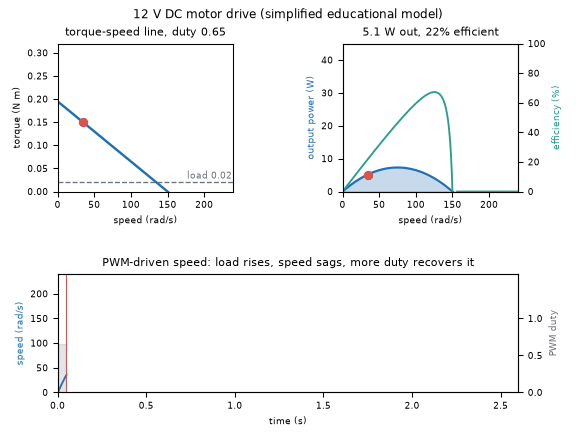
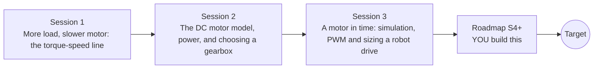

# opendcmotor

[](https://github.com/KrunalPanchal1995/opendcmotor/actions/workflows/ci.yml)   [](https://colab.research.google.com/github/KrunalPanchal1995/opendcmotor/blob/main/sessions/session-01/lesson.ipynb) [](https://krunalpanchal1995.github.io/opendcmotor/)

**Read a DC motor's torque-speed curve and choose a motor and gearbox, in three sessions.**

opendcmotor teaches how a brushed DC motor trades speed for torque, from one straight line to a time-domain simulation with PWM, using only Python and a browser.

- **Start from zero.** Session 1 needs only a straight-line graph; torque, speed and rpm are explained from scratch.
- **See it move.** Every session ships a slider app that runs in the browser, with labelled graphs.
- **Know you got it right.** Each session ends with a checkpoint that prints PASS or FAIL against hand calculations and energy conservation.
- **Build the missing half.** The repo stops at open-loop control on purpose; the roadmap shows the path to the Target.

[Target](#the-target) · [Who is this for](#who-is-this-for) · [Quick start](#quick-start) · [Sessions](#sessions) · [Roadmap](#roadmap) · [Contribute](#contribute) · [Explainer PDF](docs/explainer.pdf)

> **This repo is incomplete on purpose.** Sessions 1 to 3 are here and fully working. The finished Target below is a preview of what the community can build next. We show you the path, not the code. Sessions 4 and up are yours.

## The Target

A small drive is shown in motion. On the left, the motor's torque-speed line with a moving operating point: as the load torque rises the point slides left and the speed sags, then more PWM duty lifts the whole line and the speed recovers. In the middle, the output power and efficiency curves with the same point on them. Below, the PWM-driven speed trace over time, with the real lag of the rotor. Your goal over the coming sessions: build this closed drive yourself, then make it hold its speed automatically.



*Target: operating point on the torque-speed line, power and efficiency, and a PWM speed trace*

Try it live:

- [Math Visual Studio: open the Studio (no motor chapter has a live example yet)](https://krunalpanchal1995.github.io/studio/)

How the Target was made is shown only as a path in [promo/roadmap.md](promo/roadmap.md).

## Who is this for
**secondary school to diploma / undergraduate (levels 3-5).** Topic area: Electricity, Magnetism and Electronics.

Prerequisites:

- Straight-line graphs and simple algebra (Session 3 uses first-order differential equations, explained from scratch).
- Python 3.10 or newer; if `python --version` works, you are ready. PRIMER.md explains the rest.
- No prior electronics, GitHub or control-theory experience is needed. Everything is low voltage (12 V or less) and simulated.

New to Python? Read [PRIMER.md](PRIMER.md) first (10 minutes).

## Quick start

No installation knowledge needed. You need [Git](https://git-scm.com/downloads) and [Python 3.10+](https://www.python.org/downloads/) (Windows: tick "Add Python to PATH"). On Mac and Linux type `python3` wherever this page says `python`.

```bash
git clone https://github.com/KrunalPanchal1995/opendcmotor.git
cd opendcmotor
python start.py 1
```

`start.py` creates a private environment, installs what is needed and runs Session 1 with its checkpoint. Next: `python start.py 2`, `python start.py 3`, or `python start.py test` to check everything. Only a checkpoint: `python start.py check 1`.

A few lines turn the idea of Session 2 into a result (they work as they are): Save it as `try.py` and run it with `python start.py run try.py` (this uses the private environment, where NumPy is installed):

```python
import numpy as np
V, R, k = 12.0, 2.0, 0.05                     # volts, ohm, N m/A
T_stall, w_noload = k * V / R, V / k           # the two ends of the straight line
print(round(T_stall, 3), w_noload, round(T_stall * w_noload / 4, 2))   # N m, rad/s, peak power in W
print(np.round(np.degrees(w_noload) / 360 * 60))   # no-load speed in rpm (about 2292)
```

Every session also opens in your browser with sliders (no install): [live apps](https://krunalpanchal1995.github.io/opendcmotor/). Or use the Colab badge above for the notebook.

## Sessions

| # | Session | Model level | Time | Live app |
|---|---|---|---|---|
| 1 | [More load, slower motor: the torque-speed line](sessions/session-01/README.md) | Level 1: conceptual interactive model | 60 min | [open](https://krunalpanchal1995.github.io/opendcmotor/session-01/) |
| 2 | [The DC motor model, power, and choosing a gearbox](sessions/session-02/README.md) | Level 2: mathematical engineering model | 80 min | [open](https://krunalpanchal1995.github.io/opendcmotor/session-02/) |
| 3 | [A motor in time: simulation, PWM and sizing a robot drive](sessions/session-03/README.md) | Level 3: simulation and validation | 90 min | [open](https://krunalpanchal1995.github.io/opendcmotor/session-03/) |

Each session follows the same six steps: A real-world problem, B concept and theory, C visual explanation, D interactive simulation, E worked example and experiment, F assessment and design challenge. Each ends with `checkpoint.py`, which prints `PASS` or `FAIL` against reference numbers. Session 3 also contains the real-world mini-project: **Size a motor and gearbox for a robot wheel climbing a slope**.

## Architecture



| Folder or file | What is inside |
|---|---|
| `sessions/` | three sessions: README (A-F), `lesson.py`, notebook, live app, exercises, activity sheet, checkpoint |
| `promo/` | the Target: media, live links, and the roadmap (path only) |
| `docs/` | `explainer.tex` and the built `explainer.pdf` |
| `tests/` | runs every lesson and checkpoint headless |
| `start.py` | one command to set up and run anything |
| `QUALITY.md`, `RUBRIC.md` | the quality checklist and the scoring rubric |
| `.github/` | CI, PDF build, Pages deploy, issue and PR templates |

## Roadmap

| Milestone | What you will build | Difficulty |
|---|---|---|
| Session 4: Climb steeper: the 35 degree drive | A drive study that extends `window` to compare motors, supply voltages and gear stages. | intermediate |
| Session 5: Hold the speed: closed-loop control | A PI speed controller that sets the duty cycle from the speed error, added to the time-domain simulation. | advanced |
| Session 6: Measure your own motor | A parameter-fitting script and a bench procedure for a real hobby motor. | intermediate |
| Session 7: Battery sag and a thermal limit | A battery model and a one-state thermal model for the winding, wired into the simulation. | advanced |
| Session 8: Downhill and regenerative braking | A descent simulation of the robot with the motor acting as a generator. | advanced |

Full detail with a checkpoint per milestone: [promo/roadmap.md](promo/roadmap.md).

## Contribute
New to GitHub? Read [CONTRIBUTING.md](CONTRIBUTING.md); it starts from zero. Pick an issue labelled `good first issue`. Translations into Hindi, Telugu, Tamil and Malayalam are welcome.

<details>
<summary>Development</summary>

```bash
python start.py test        # runs every lesson and checkpoint
```
Lessons use `# %%` cell markers so they open as notebooks in VS Code. See [QUALITY.md](QUALITY.md) for the standard every session meets.
</details>

## License
MIT. See [LICENSE](LICENSE). Media in `promo/media` is (c) Krunal Panchal, CC BY 4.0.

## Acknowledgments
Part of the [PAN IIT OSS](https://hellofoss.tech-iitb.org/projects) open-source teaching collection, modelled on the structure of [openspline](https://github.com/openspline/openspline). Built on ideas from the Math Visual Studio at https://krunalpanchal1995.github.io/studio/.
