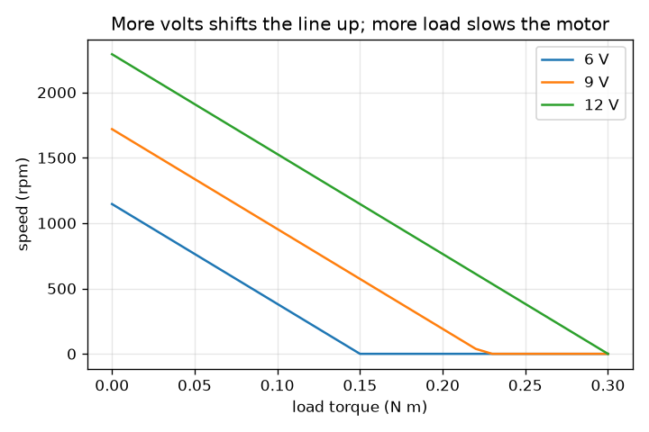
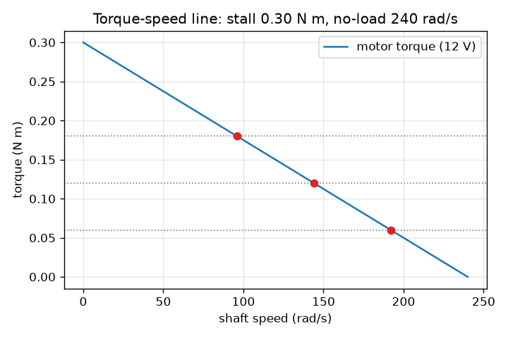

# Session 1: More load, slower motor: the torque-speed line

*Level 1 (conceptual interactive model) · about 60 minutes · opendcmotor*

> This is a simplified educational model. It is not a validated design tool and must not be used for real structures, electrical installations, vehicles, industrial processes or medical decisions.

**Prerequisites**

- Reading a straight-line graph.
- You have read PRIMER.md and run `python start.py 1` once.

**Learning objectives.** After this session you can:

- Explain what torque and speed are, and use rad/s and rpm.
- Read the stall torque and the no-load speed off a motor's torque-speed line.
- Find the steady speed of a motor under a given load torque.
- Explain what happens to the line when the supply voltage changes.

## A. Real-world problem
A small 12 V motor spins a toy wheel quickly. Hang a heavy load on it and it slows down. Hold the shaft with your hand and it stops, hums, and soon gets warm. How does the speed depend on the load, and can we capture that in one simple picture? Everything here is a simplified, low-voltage educational model, not a design tool.

## B. Concept and theory
Torque is the twisting effort of a shaft, measured in newton metres (N m). Speed is how fast it turns: in radians per second (rad/s) or in revolutions per minute (rpm); one turn is 2 pi radians, so rpm = rad/s x 60 / (2 pi). A brushed DC motor has a straight torque-speed line. At zero speed (the shaft is held) the motor gives its largest torque, the stall torque. As it speeds up the torque it can give falls until, at the no-load speed, it gives none. When the motor drives a steady load, it settles where the load torque meets the line. A load above the stall torque cannot be turned. Raising the supply voltage lifts the line: both the stall torque and the no-load speed grow in proportion to the voltage (Session 2 derives this). The example motor at 12 V has a stall torque of 0.30 N m and a no-load speed of 240 rad/s.

| Symbol | Meaning | Unit |
|---|---|---|
| T | torque the motor gives | N m |
| w | shaft speed | rad/s |
| T_stall | torque at zero speed | N m |
| w_noload | speed at zero torque | rad/s |
| T_load | torque the load asks for | N m |
| P | mechanical power, torque times speed | W |

**Assumptions**

- The torque-speed relation is an exact straight line (true for the ideal brushed DC motor, approximately true for real ones).
- The load torque is steady and opposes the motion.
- Supply voltage is steady and low (12 V or less); temperature effects are ignored.

$$ T(\omega)=T_{\mathrm{stall}}\left(1-\frac{\omega}{\omega_{\mathrm{noload}}}\right) $$

$$ \omega=\omega_{\mathrm{noload}}\left(1-\frac{T_{\mathrm{load}}}{T_{\mathrm{stall}}}\right)\quad(T_{\mathrm{load}}<T_{\mathrm{stall}}) $$

$$ \mathrm{rpm}=\omega\,\frac{60}{2\pi} $$

$$ P=T_{\mathrm{load}}\,\omega $$

## C. Visual explanation
The first figure shows the 12 V torque-speed line from 0.30 N m at rest down to zero at 240 rad/s, with three loads drawn as dotted horizontal lines and the operating points where they meet the line. The second figure plots speed against load for 6, 9 and 12 V: three parallel-looking lines that fall as the load grows and shift up with voltage. Reading either picture: a heavier load means a slower motor, and a motor never runs faster than its no-load speed.

*Speed against load for 6, 9 and 12 V: heavier load, slower motor; more volts, faster motor.*

*The 12 V torque-speed line with the operating points for three loads.*

## D. Interactive simulation
Run the lesson (`python start.py 1`), then open the live app: [Session 1: load and speed](https://krunalpanchal1995.github.io/opendcmotor/session-01/) (or `app.html` in this folder). Slide the load and watch the needle and the red point on the line, then change the voltage and see the line move. Try a load larger than the stall torque.

**Challenge.** Make the shaft turn at 1000 rpm or more while carrying a load of at least 0.15 N m.

## E. Worked example and experiment
**Problem.** The 12 V motor (stall torque 0.30 N m, no-load speed 240 rad/s) drives a load of 0.12 N m. Find its speed in rad/s and rpm, and the mechanical power.

1. Load as a fraction of stall: 0.12 / 0.30 = 0.4.
2. Speed = 240 x (1 - 0.4) = 144 rad/s.
3. rpm = 144 x 60 / (2 pi) = 1375 rpm (to 4 digits, 1375.1).
4. Power = torque x speed = 0.12 x 144 = 17.28 W.
5. Sanity check: the speed is between 0 and 240 rad/s, and the load is below the stall torque, so the motor turns.

**Answer.** 144 rad/s, about 1375 rpm, delivering 17.28 W.

**Experiment.** Take a small hobby gear motor and a 12 V supply (with adult help), and measure the free-running speed with a phone strobe app or by counting marked turns. Then press the shaft lightly with a finger wrapped in cloth: the speed falls as the model says. Real motors give a slightly curved line, show friction and heat up, and the voltage sags under load. The model keeps only the main straight-line trend; this is a classroom model, not a measurement of any specific motor.

## F. Assessment and design challenge
**Question type A: Conceptual.** Why does a motor slow down when the load grows? Why does it never turn faster than the no-load speed?

Hint

Where does the straight line cross the speed axis, and what torque is left there?

Step-by-step solution

The motor can only give the torque the line allows at its present speed. A heavier load asks for more torque, which the line only offers at a lower speed, so the motor settles slower. At the no-load speed the line says the motor gives zero torque, so there is nothing left to push it faster. A load of zero therefore gives the highest speed, the no-load speed.

**Question type B: Numerical.** The 12 V motor drives a load of 0.21 N m. Find the speed in rad/s and rpm. Then find the load torque that gives exactly half the no-load speed.

Hint

Use speed = 240 x (1 - load / 0.30). Half speed means (1 - load / 0.30) = 0.5.

Step-by-step solution

Fraction of stall: 0.21 / 0.30 = 0.7, so speed = 240 x 0.3 = 72 rad/s, which is 72 x 60 / (2 pi) = 687.5 rpm. Half the no-load speed (120 rad/s) needs 1 - load / 0.30 = 0.5, so load = 0.15 N m. Sanity check: 0.15 is half of the stall torque, as the straight line demands.

**Question type C: Graph and simulation interpretation.** In the speed-versus-load graph, what does the 6 V line do compared with the 12 V line? At what load does each reach zero speed?

Hint

Remember that both the stall torque and the no-load speed scale with voltage.

Step-by-step solution

The 6 V line starts at half the speed (1146 rpm against 2292 rpm at no load) and reaches zero speed at half the load, 0.15 N m instead of 0.30 N m. The 9 V line lies in between, stalling at 0.225 N m. So a lower voltage shrinks both the top speed and the load the motor can carry.

**Question type D: Design and optimisation challenge.** A load needs 0.15 N m at no less than 1000 rpm (104.7 rad/s). Can the 12 V motor do it? What is the lowest voltage in 0.5 V steps that does it?

Hint

At voltage V the line has stall torque 0.025 V and no-load speed 20 V. Solve speed = 20 V (1 - 0.15 / (0.025 V)) >= 104.7.

Step-by-step solution

At 12 V the speed is 240 x (1 - 0.15 / 0.30) = 120 rad/s = 1146 rpm, which is above 1000 rpm, so yes. The speed at voltage V is 20 V - 120, so 20 V - 120 >= 104.7 gives V >= 11.24; in 0.5 V steps the lowest voltage is 11.5 V. Trade-off: the motor then runs close to its limits; a motor with a bigger stall torque would run cooler.

Score yourself with [RUBRIC.md](../../RUBRIC.md). Print the [activity sheet](activity_sheet.md) to work on paper.

## Common misconceptions
| Common misconception | What is actually true |
|---|---|
| A motor has one fixed speed. | A motor has a speed for each load; the speed falls along a line as the load rises. |
| More load always gives more power. | Power is torque times speed. It is zero at no load and zero at stall, and largest in between (here 18 W at 0.15 N m). |
| Torque and speed are the same thing. | Torque is twisting effort (N m); speed is turning rate (rad/s or rpm). The line trades one for the other. |
| A stalled motor is safe because it is not moving. | A stalled motor still draws its largest current and turns it all into heat. Session 3 shows how much. |

## Glossary
- **torque**: twisting effort of a shaft, in newton metres (N m)
- **rad/s**: radians per second; one full turn is 2 pi radians
- **rpm**: revolutions per minute
- **stall torque**: the torque at zero speed, the most the motor can give
- **no-load speed**: the speed with nothing to turn, the most the motor can reach
- **operating point**: the speed and torque where motor line and load meet

## Finish
1. Do the three coding tasks in [exercises.md](exercises.md).
2. Run `python start.py 1` again after your changes. It ends with the checkpoint; when it prints `PASS`, you are done. (Checkpoint only: `python start.py check 1`.)

Next: [Session 2](../session-02/README.md)
