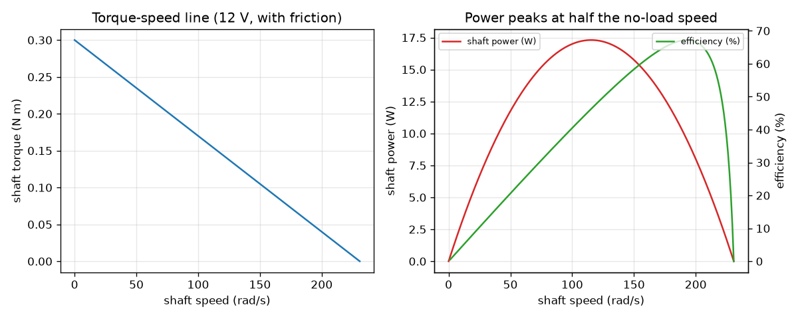
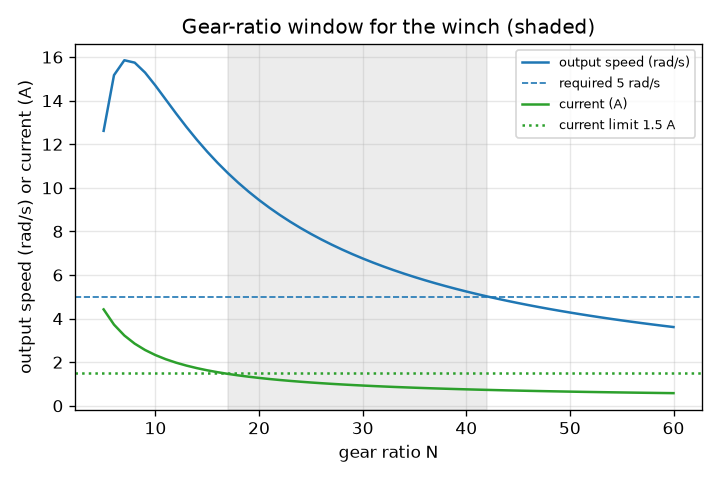

# Session 2: The DC motor model, power, and choosing a gearbox

*Level 2 (mathematical engineering model) · about 80 minutes · opendcmotor*

> This is a simplified educational model. It is not a validated design tool and must not be used for real structures, electrical installations, vehicles, industrial processes or medical decisions.

**Prerequisites**

- Session 1: the torque-speed line.
- Ohm's law V = I R and electrical power P = V I.

**Learning objectives.** After this session you can:

- Write the two DC motor equations and derive the torque-speed line from them.
- Verify the line numerically and show why k_t equals k_e in SI units.
- Find the speed of peak power and the efficiency there, with and without friction.
- Choose a gear ratio so that a motor lifts a load at a required speed within a current limit.

## A. Real-world problem
You must lift a 5 kg load at a steady pace with a small 12 V motor and a winch drum of radius 2 cm. The bare motor spins fast but is weak; a gearbox trades speed for torque. What gear ratio lifts the load at the speed you want without drawing too much current? (A simplified, low-voltage educational model, not a design tool.)

## B. Concept and theory
Two equations describe the motor. Electrical: the supply voltage V pushes a current I through the winding resistance R, and the spinning rotor makes a back voltage k_e w that opposes it, so V = I R + k_e w. Mechanical: torque is proportional to current, T = k_t I. In SI units k_t and k_e are the same number k (N m/A is the same as V s/rad), because the electrical power that goes into the back voltage, k_e w I, must come out as mechanical power T w = k_t I w. Eliminating I gives the straight line T = k (V - k w) / R. At w = 0 this is the stall torque T_stall = k V / R, with stall current V / R; at T = 0 it is the no-load speed w_noload = V / k. Efficiency is mechanical output over electrical input, T w / (V I) = w / w_noload for the ideal motor, and the output power T w is a parabola peaking at half the no-load speed, where the efficiency is exactly 50 percent. Real motors lose some torque to friction; with viscous friction b the line becomes T = T0 - a w with a = k^2/R + b, the peak moves slightly down and the efficiency at the peak falls below 50 percent. A gearbox of ratio N and efficiency eta turns motor torque T_m and speed w_m into output torque N eta T_m and speed w_m / N.

| Symbol | Meaning | Unit |
|---|---|---|
| V | supply voltage | V |
| I | winding current | A |
| R | winding resistance | ohm |
| k | motor constant, k_t = k_e | N m/A = V s/rad |
| w | shaft speed | rad/s |
| T | shaft torque | N m |
| b | viscous friction coefficient | N m s/rad |
| N, eta | gear ratio and gearbox efficiency | no unit |

**Assumptions**

- Steady state: inductance and inertia play no part yet (Session 3 adds them).
- Constant R and k, no temperature or saturation effects, no brush voltage drop.
- Friction is viscous (proportional to speed); the gearbox has a constant efficiency of 0.9.
- Example motor: V = 12 V, R = 2.0 ohm, k = 0.05 N m/A, b = 5e-5 N m s/rad.

$$ V=IR+k_e\omega,\qquad T=k_tI,\qquad k_t=k_e=k $$

$$ T=\frac{k\,(V-k\omega)}{R}=T_{\mathrm{stall}}\left(1-\frac{\omega}{\omega_{\mathrm{noload}}}\right),\quad T_{\mathrm{stall}}=\frac{kV}{R},\ \ \omega_{\mathrm{noload}}=\frac{V}{k} $$

$$ P_{\mathrm{in}}=VI,\qquad P_{\mathrm{out}}=T\omega,\qquad \eta_{\mathrm{motor}}=\frac{T\omega}{VI}=\frac{\omega}{\omega_{\mathrm{noload}}}\ \ (b=0) $$

$$ P_{\mathrm{out}}(\omega)=T_{\mathrm{stall}}\,\omega\left(1-\frac{\omega}{\omega_{\mathrm{noload}}}\right),\quad \omega^{*}=\frac{\omega_{\mathrm{noload}}}{2},\ \ P_{\max}=\frac{T_{\mathrm{stall}}\,\omega_{\mathrm{noload}}}{4} $$

$$ T_{\mathrm{out}}=N\eta_g T_m,\qquad \omega_{\mathrm{out}}=\frac{\omega_m}{N} $$

## C. Visual explanation
The first figure has two panels. On the left, the torque-speed line of the 12 V motor with friction. On the right, shaft power (red) peaks at 115.4 rad/s, and efficiency (green) rises steadily with speed, so the point of maximum power (46.3 percent efficient) is not the point of best efficiency. The second figure shows the gear-ratio window for the winch: output speed falls and current falls as the ratio grows; the shaded band, ratios 17 to 42, is where the speed is at least 5 rad/s and the current at most 1.5 A.

*Torque-speed line (left), shaft power and efficiency against speed (right), with friction.*

*Gear-ratio window for the winch: speed above 5 rad/s and current below 1.5 A.*

## D. Interactive simulation
Run the lesson (`python start.py 2`), then open the live app: [Session 2: the winch design](https://krunalpanchal1995.github.io/opendcmotor/session-02/) (or `app.html` in this folder). Change the voltage and the gear ratio. Watch the load line (grey) slide on the motor line, the power view for input and output, and the window view for speed and current against the ratio.

**Challenge.** Lift the 5 kg load with a drum speed of at least 5 rad/s and a motor current of at most 1.5 A.

## E. Worked example and experiment
**Problem.** For the motor V = 12 V, R = 2.0 ohm, k = 0.05 N m/A: find the stall torque, stall current, no-load speed, peak power and efficiency there. Then choose the best gear ratio for the winch (load torque 0.981 N m, drum speed at least 5 rad/s, current at most 1.5 A, gearbox efficiency 0.9, friction b = 5e-5).

1. Stall torque = k V / R = 0.05 x 12 / 2 = 0.300 N m; stall current = V / R = 6 A.
2. No-load speed = V / k = 12 / 0.05 = 240 rad/s = 2292 rpm.
3. Ideal peak power = T_stall x w_noload / 4 = 0.3 x 240 / 4 = 18.00 W at 120 rad/s, where the efficiency is w / w_noload = 50 percent.
4. With friction: a = k^2/R + b = 0.00125 + 0.00005 = 0.0013; the shaft line is T = 0.300 - 0.0013 w, which reaches zero at 230.8 rad/s. Peak power = 0.3 x 230.8 / 4 = 17.31 W at 115.4 rad/s; there I = (12 - 0.05 x 115.4) / 2 = 3.12 A, input power 37.4 W, so efficiency = 17.31 / 37.4 = 46.3 percent (below 50).
5. Load: the drum torque is 5 x 9.81 x 0.02 = 0.981 N m. For ratio N the motor must give T_m = 0.981 / (0.9 N) and runs where 0.300 - 0.0013 w = T_m.
6. Scanning ratios 5 to 60: N = 17 to 42 meet drum speed >= 5 rad/s and current <= 1.5 A. N = 16 draws 1.54 A (too much); N = 43 gives 4.91 rad/s (too slow).
7. Best efficiency in the window: N = 22. Motor torque 0.0496 N m, motor speed 192.7 rad/s (1840 rpm), drum speed 8.76 rad/s = 0.175 m/s, current 1.18 A, overall efficiency 60.5 percent.

**Answer.** T_stall = 0.300 N m, I_stall = 6 A, w_noload = 240 rad/s (2292 rpm); ideal peak 18.00 W at 120 rad/s and 50 percent efficiency, 17.31 W at 115.4 rad/s and 46.3 percent with friction. For the winch use N = 22 (allowed window 17 to 42): 8.76 rad/s, 1.18 A, 60.5 percent.

**Experiment.** With a small geared motor, a variable 12 V supply and a multimeter (adult help), measure the stall current with the shaft held for one second only, and the no-load current and speed. From V / I_stall get R; from the no-load speed get k = V / w. Compare with the data sheet. Real values differ because the brushes drop about a volt, R rises as the winding warms, and gearboxes are less efficient at low load. The model has none of those: it is accurate for trends and first estimates only.

## F. Assessment and design challenge
**Question type A: Conceptual.** Why is the efficiency at maximum power below 50 percent in a real motor, and why is the best-efficiency speed higher than the best-power speed?

Hint

Efficiency of the ideal motor is w / w_noload. What does friction subtract from the shaft power but not from the electrical input?

Step-by-step solution

For the ideal motor, efficiency is the speed fraction w / w_noload, exactly 0.5 at the speed of peak power. Friction takes a share of the torque, so the shaft power is less than k I w, while the electrical input V I is unchanged, so the efficiency at that speed drops below 50 percent (46.3 percent here). Efficiency keeps rising with speed because the current (and so the resistive loss) falls as the back voltage grows, while power falls to zero at no load. Best efficiency (67 percent here) is therefore near 193 rad/s, well above the 115 rad/s of peak power.

**Question type B: Numerical.** A motor has V = 6 V, R = 1.5 ohm, k = 0.03 N m/A (no friction). Find the stall torque, stall current, no-load speed (rad/s and rpm) and peak mechanical power.

Hint

T_stall = k V / R, w_noload = V / k, P_max = T_stall w_noload / 4.

Step-by-step solution

T_stall = 0.03 x 6 / 1.5 = 0.12 N m. I_stall = 6 / 1.5 = 4 A. w_noload = 6 / 0.03 = 200 rad/s = 200 x 60 / (2 pi) = 1910 rpm. P_max = 0.12 x 200 / 4 = 6.0 W at 100 rad/s. Sanity check: P_max is 6 W while the electrical power at stall would be 24 W, a quarter of it, as expected.

**Question type C: Graph and simulation interpretation.** In the gear-ratio window graph, what happens to the output speed and to the current as the ratio grows from 17 to 42? Which limit decides the lower end of the window and which the upper end?

Hint

Look at which curve crosses its flat limit line at each end.

Step-by-step solution

As the ratio grows the output speed falls (10.7 to 5.0 rad/s) and the current falls too (1.46 to 0.73 A), because the motor torque needed falls as 1 / N. The lower end of the window, N = 17, is set by the current limit (N = 16 draws 1.54 A); the upper end, N = 42, is set by the speed requirement (N = 43 gives only 4.91 rad/s).

**Question type D: Design and optimisation challenge.** Design: lift a 3 kg load on the same 2 cm drum at a drum speed of at least 8 rad/s with at most 1.5 A. Which ratios work and which would you choose? State the trade-off.

Hint

Load torque = 3 x 9.81 x 0.02. Scan N with the Session 2 functions `operating_point` and `choose_ratio`.

Step-by-step solution

Load torque = 0.5886 N m. The window is N = 10 to 26. The most efficient is N = 13 (14.77 rad/s, 1.20 A, 60.5 percent efficiency). Trade-off: a low ratio (near 10) lifts faster but draws more current and heats the motor; a high ratio (near 26) is gentle on the motor but barely meets the speed requirement and wastes speed capability. Choosing about 13 to 15 keeps margin on both limits.

Score yourself with [RUBRIC.md](../../RUBRIC.md). Print the [activity sheet](activity_sheet.md) to work on paper.

## Common misconceptions
| Common misconception | What is actually true |
|---|---|
| A motor gives constant torque whatever its speed. | The torque falls linearly with speed because the back voltage reduces the current. |
| The motor is most efficient where it gives the most power. | At peak power the ideal efficiency is exactly 50 percent and the real one is lower; efficiency keeps rising with speed. |
| A gearbox gives you more power. | A gearbox trades speed for torque; the output power is the input power times the gearbox efficiency, so it is always a little less. |
| k_t and k_e are two different constants to measure. | In SI units they are equal; the energy balance k_e w I = k_t I w forces it. |

## Glossary
- **back voltage**: the voltage a spinning motor makes, proportional to speed, which opposes the supply
- **motor constant k**: N m of torque per ampere, equal to volts per rad/s
- **stall current**: V / R, the current when the shaft is held
- **efficiency**: useful output power divided by input power
- **gear ratio**: motor turns per output turn; torque is multiplied and speed divided by it
- **peak power**: the maximum output power, at half the no-load speed for the ideal motor

## Finish
1. Do the three coding tasks in [exercises.md](exercises.md).
2. Run `python start.py 2` again after your changes. It ends with the checkpoint; when it prints `PASS`, you are done. (Checkpoint only: `python start.py check 2`.)

Next: [Session 3](../session-03/README.md)
