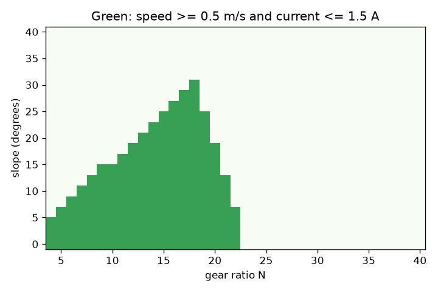
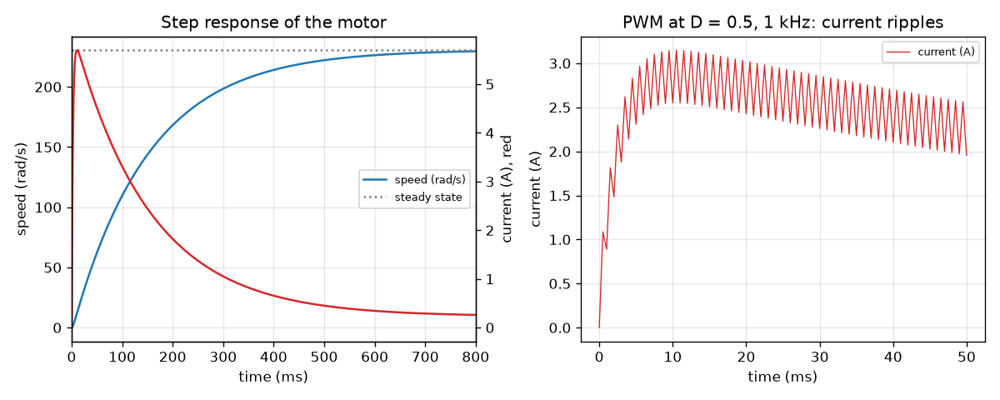

# Session 3: A motor in time: simulation, PWM and sizing a robot drive

*Level 3 (simulation and validation) · about 90 minutes · opendcmotor*

> This is a simplified educational model. It is not a validated design tool and must not be used for real structures, electrical installations, vehicles, industrial processes or medical decisions.

**Prerequisites**

- Session 1: the torque-speed line.
- Session 2: the motor equations, power and gearing.
- Idea of a rate of change (derivative); everything else is explained in Section B.

**Learning objectives.** After this session you can:

- Write the coupled electrical and mechanical equations and solve them with RK4.
- Validate the simulation against the steady-state line, against the time-constant formulas and against energy conservation.
- Explain PWM speed control, the inrush current at start, and the stall failure case with numbers.
- Size a motor and gearbox for a robot climbing a slope, using a sweep and a time-domain check.

## A. Real-world problem
A real motor does not jump to its steady speed. Switch it on and the current spikes first, because the rotor is still and there is no back voltage; then the speed climbs and the current falls. A robot also controls speed by switching the supply on and off very fast (PWM). And a robot that climbs a ramp must have the right motor and gearbox. Can we simulate all of this, trust the simulation, and use it to decide? (Low-voltage simplified lumped model, for education only: never wire a real motor or battery from this lesson alone.)

## B. Concept and theory
Add the two things Session 2 left out: the winding inductance L, which makes the current take time to change, and the inertia J of the rotor and load, which makes the speed take time to change. Electrical: L di/dt = V - R i - k w. Mechanical: J dw/dt = k i - b w - T_load. These two coupled first-order equations have no neat formula in general, so we step through time with RK4 (Runge-Kutta 4): four slope samples per step, error shrinking with the fourth power of the step. Two time constants appear: tau_e = L / R (2.5 ms here, fast) and tau_m = J R / (k^2 + b R) (153.8 ms here, slow). Because tau_e is much shorter than tau_m, the speed follows a simple rise 1 - exp(-t / tau_m) towards the steady speed from the Session 2 line. PWM switches the supply V fully on for a fraction D (the duty cycle) of each period and off for the rest; the motor sees the average voltage D V, and since the rotor is slow its speed ripple is tiny, but the current ripple is about D (1 - D) V / (L f) for PWM frequency f. Energy must balance: the electrical energy in equals heat in the winding (R i^2) plus friction heat (b w^2) plus the work done on the load (T_load w) plus the stored energy 1/2 J w^2 (rotor) and 1/2 L i^2 (inductor). The starting margin of a geared drive is the torque it gives at stall, N eta k V / R, divided by the torque the task needs. A locked rotor (stall) has w = 0, so the current tends to V / R and the winding heat is R i^2 = V^2 / R.

| Symbol | Meaning | Unit |
|---|---|---|
| L | winding inductance | H |
| J | rotor plus load inertia | kg m^2 |
| i, w | current and speed (the state) | A, rad/s |
| tau_e, tau_m | electrical and mechanical time constants | s |
| D | PWM duty cycle, 0 to 1 | no unit |
| f | PWM frequency | Hz |
| m, r, theta, c | robot mass, wheel radius, slope angle, rolling-resistance coefficient | kg, m, degrees, no unit |
| dt | RK4 time step | s |

**Assumptions**

- Lumped model: constant R, L, k, J, b; no brush drop, no saturation, no temperature change.
- PWM is ideal: the supply is exactly V or 0 and current may flow both ways (a motor with brake mode).
- The stall heating uses an assumed heat capacity of 15 J/K and no cooling, so it is an upper bound on how fast the winding warms.
- The robot drives up a straight slope at steady speed; wheels do not slip; rolling resistance is a constant fraction c of the normal force.

$$ L\frac{di}{dt}=V-Ri-k\omega,\qquad J\frac{d\omega}{dt}=ki-b\omega-T_{\mathrm{load}} $$

$$ \tau_e=\frac{L}{R},\qquad \tau_m\approx\frac{JR}{k^2+bR},\qquad \omega(t)\approx\omega_{ss}\left(1-e^{-t/\tau_m}\right) $$

$$ \omega_{ss}=\frac{kV/R-T_{\mathrm{load}}}{k^2/R+b},\qquad V_{\mathrm{avg}}=DV,\qquad \Delta i\approx\frac{D(1-D)V}{Lf} $$

$$ \int Vi\,dt=\int Ri^2\,dt+\int b\omega^2\,dt+\int T_{\mathrm{load}}\omega\,dt+\tfrac12J\omega^2+\tfrac12Li^2 $$

$$ F=mg\,(\sin\theta+c\cos\theta),\qquad T_{\mathrm{wheel}}=\frac{Fr}{n},\qquad T_m=\frac{T_{\mathrm{wheel}}}{N\eta} $$

## C. Visual explanation
The first figure has two panels. On the left, the step response of the motor at 12 V with no load: speed (blue) climbs smoothly to 230.8 rad/s with a time constant of about 154 ms, while the current (red) spikes to 5.7 A within 10 ms and then settles near 0.24 A. On the right, the current during PWM at D = 0.5 and 1 kHz is a sawtooth about 0.6 A peak to peak, while the speed barely moves (0.02 rad/s). The second figure is the sizing sweep for the robot: the green region, slope against gear ratio, is where speed is at least 0.5 m/s and current at most 1.5 A. It narrows as the slope grows and vanishes above 31 degrees.

*Sizing sweep for the 8 kg robot: green marks gear ratio and slope combinations that meet speed and current limits.*

*Left: step response, speed (blue) and current (red). Right: PWM current ripple at D = 0.5 and 1 kHz.*

## D. Interactive simulation
Run the lesson (`python start.py 3`), then open the live app: [Session 3: PWM motor simulation](https://krunalpanchal1995.github.io/opendcmotor/session-03/) (or `app.html` in this folder). Use the duty, load and PWM frequency sliders. Look at the speed step response, the switch-on current, and the current ripple over three PWM periods. Compare the ripple in the readout with the hand estimate.

**Challenge.** Reach a steady speed of at least 100 rad/s against the load while keeping the current ripple at or below 0.3 A.

## E. Worked example and experiment
**Problem.** A 12 V motor (R = 2.0 ohm, L = 5 mH, k = 0.05, b = 5e-5, J = 2e-4 kg m^2) starts from rest with no load. Find tau_e, tau_m, the steady speed and current, then check them against the RK4 simulation and the energy balance.

1. tau_e = L / R = 0.005 / 2 = 2.5 ms.
2. tau_m = J R / (k^2 + b R) = 2e-4 x 2 / (0.0025 + 0.0001) = 4e-4 / 0.0026 = 0.1538 s.
3. Steady speed = (k V / R) / (k^2/R + b) = 0.3 / 0.0013 = 230.77 rad/s; steady current = b w / k = 5e-5 x 230.77 / 0.05 = 0.231 A.
4. The first-order approximation says 63.2 percent of the final speed (145.8 rad/s) is reached at t = tau_m = 153.8 ms.
5. Simulation (RK4, dt = 0.1 ms): the speed reaches 63.2 percent at 154.0 ms, within 0.2 percent of the formula; the current peaks at 5.70 A (below the stall limit V / R = 6 A) at 10.7 ms.
6. Energy: in one second the supply delivers 13.41 J; the sum of winding heat, friction heat, stored kinetic and magnetic energy matches it with a residual of about 5e-9 J.

**Answer.** tau_e = 2.5 ms, tau_m = 153.8 ms, steady 230.77 rad/s and 0.231 A; the simulation gives 154.0 ms for 63.2 percent speed, a start-up current peak of 5.70 A, and conserves energy to 5e-9 J.

**Experiment.** Connect a small motor to a 6 V supply (adult help), record the sound or a phone video of a marked wheel and note when it reaches about two thirds of its final speed; compare it with tau_m = J R / (k^2 + b R) once you estimate J. Differences come from the brush drop, from friction that is not exactly viscous (stiction and Coulomb friction), and from J of the attached load. The first-order model is excellent when tau_e is much smaller than tau_m; for a very small, light motor with a big inductance the model would need the full second-order solution.

## Real-world application and mini-project: Size a motor and gearbox for a robot wheel climbing a slope
A robot of 8 kg runs on two driven wheels of radius 0.05 m (rolling resistance coefficient 0.03). Each wheel has one of the 12 V motors from the lessons and a gearbox of efficiency 0.9. The robot must climb a 25 degree ramp at 0.5 m/s or more, each motor may draw at most 1.5 A continuously, and the gearbox must give a starting-torque margin of at least 1.5. Use `window` and `wheel_drive` from Session 3 to list the allowed gear ratios, pick one with an engineering argument, and confirm your pick with `climb_sim`.

**Deliverable:** A script that prints the table of speed, current, starting margin and efficiency for ratios 10 to 24 at 25 degrees, names the allowed window and your chosen ratio, simulates the climb from rest in the time domain, and saves a speed-versus-ratio and current-versus-ratio plot with the limits drawn on it. Add a short paragraph on why you did not pick the very edge of the window.

**Success looks like:** The window is 15 to 19 (the most efficient ratio is 19 at 60.5 percent, but its speed is only 0.503 m/s, so a ratio of 17 or 18 leaves a speed margin), the simulated climb speed agrees with the steady-state value within 1 percent, and your write-up states that the steepest slope this motor can climb under the same limits is 31 degrees.

## F. Assessment and design challenge
**Question type A: Conceptual.** Why is the speed ripple in PWM almost zero while the current ripple is clearly visible?

Hint

Compare the PWM period (1 ms) with tau_e (2.5 ms) and tau_m (153.8 ms).

Step-by-step solution

The inductance makes the current respond over a time tau_e = 2.5 ms, comparable with the 1 ms PWM period, so the current visibly rises during the on-time and falls during the off-time. The rotor's inertia makes the speed respond over tau_m = 153.8 ms, 150 times longer than the period, so it averages the torque pulses and barely moves (0.02 rad/s peak to peak). The mean speed is therefore the speed at the average voltage D V.

**Question type B: Numerical.** The load inertia is doubled to J = 4e-4 kg m^2. Find the new mechanical time constant, and the time for the speed to reach 63.2 percent. How does the steady speed change?

Hint

tau_m = J R / (k^2 + b R). Steady speed does not contain J.

Step-by-step solution

tau_m = 4e-4 x 2 / 0.0026 = 0.3077 s (twice as long). The simulation gives 0.3078 s for 63.2 percent of the final speed. The steady speed 230.77 rad/s is unchanged, since J appears only in the equation for how fast the speed changes, not in the balance where the derivatives are zero.

**Question type C: Graph and simulation interpretation.** In the PWM current graph, what happens to the ripple when you double the frequency from 1000 to 2000 Hz at D = 0.5? What does the hand estimate predict and why does it fall?

Hint

Use the estimate D (1 - D) V / (L f).

Step-by-step solution

The estimate gives 0.25 x 12 / (0.005 x 1000) = 0.60 A at 1 kHz and 0.30 A at 2 kHz: the ripple halves, because each on or off interval is half as long so the current has half as much time to change. The simulation gives 0.598 A and 0.300 A. Higher frequency means smoother current but more switching loss in a real driver, which the model does not include.

**Question type D: Design and optimisation challenge.** Design: a 5 kg robot with the same wheels (radius 0.05 m, two driven wheels, c = 0.03) must climb 25 degrees at 0.5 m/s or more with at most 1.5 A per motor and a starting margin of at least 1.5. Which gear ratios work? Which would you choose?

Hint

Call `window(25, robot={'m': 5.0})` and `wheel_drive` for the ratios at the edges.

Step-by-step solution

The window is N = 10 to 20 (N = 9 draws 1.54 A, N = 21 gives only 0.496 m/s). The most efficient is N = 12: 0.798 m/s, 1.21 A, starting margin 5.9, efficiency 60.5 percent. I would choose about 12 to 14: well inside both limits, faster than needed. Trade-off: a higher ratio runs cooler and has more torque margin but is slower and wastes efficiency; a lower ratio is faster but near the current limit.

Score yourself with [RUBRIC.md](../../RUBRIC.md). Print the [activity sheet](activity_sheet.md) to work on paper.

## Common misconceptions
| Common misconception | What is actually true |
|---|---|
| The current at switch-on is limited to its steady value. | At switch-on the rotor is still, so there is no back voltage and the current rushes towards V / R (5.7 A here against 0.24 A at steady no-load speed). |
| PWM at 50 percent duty gives half the torque and half the speed at all loads. | It gives the average voltage D V, so the torque-speed line moves down; the speed at a given load is the one on that lower line. |
| A bigger load inertia lowers the final speed. | Inertia only slows how fast the speed changes (tau_m grows); the final speed is set by the voltage and the load torque. |
| A simulation that runs is a simulation that is right. | You validate it: against the steady-state line, against the time-constant formula, against energy conservation, and by halving the time step. |

## Glossary
- **RK4**: Runge-Kutta 4, a step-by-step method that samples the slope four times per step
- **time constant**: the time for a first-order response to cover 63.2 percent of its change
- **PWM**: pulse-width modulation: switching the supply on and off fast to set an average voltage
- **duty cycle**: the fraction of each PWM period that the supply is on
- **inrush current**: the large current at switch-on while the rotor is still
- **starting margin**: stall torque at the wheel divided by the torque the slope needs; above 1 the robot can start
- **stall**: the shaft cannot turn; current is V / R and all the power becomes heat
- **inductance**: property of a coil that opposes changes of current

## Finish
1. Do the three coding tasks in [exercises.md](exercises.md).
2. Run `python start.py 3` again after your changes. It ends with the checkpoint; when it prints `PASS`, you are done. (Checkpoint only: `python start.py check 3`.)

Next: the [roadmap](../../promo/roadmap.md). Session 4 is yours to build.
